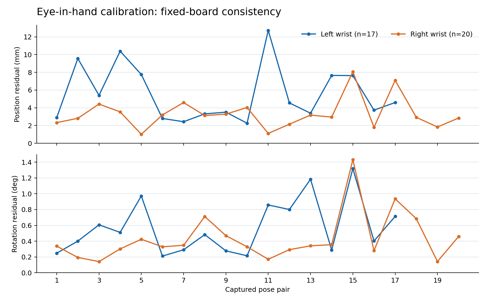
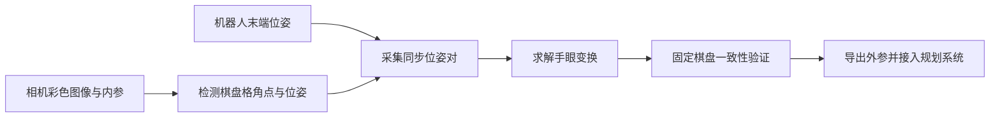

# Three-Camera Hand–Eye Calibration

面向顶部、左腕和右腕 RealSense 相机的 ROS 2 标定工具。支持棋盘格位姿检测、Eye-in-Hand 手眼标定、固定棋盘外参求解、结果复算以及采样一致性验证。



上图由仓库中的左右腕相机[标定样本](docs/examples/)计算得到，分别展示固定棋盘在机器人基座坐标系中的位置和姿态残差。运行 `python3 plot_handeye_validation.py` 可重新生成。

## 标定流程



Eye-in-Hand 的输出为 `T_gripper_camera`：将相机坐标系中的三维点变换到夹爪末端坐标系。与机器人实时位姿组合后，得到 `T_base_camera = T_base_gripper × T_gripper_camera`。左、右腕相机需要分别标定；顶部固定相机使用 `compute_fixed_board_extrinsic.py` 的固定棋盘流程。坐标系和验证方法见[方法说明](docs/method.md)。

## 环境

需要 ROS 2 Jazzy、`rclpy`、`geometry_msgs`、`sensor_msgs`、OpenCV、NumPy；绘制验证图还需要 Matplotlib。相机驱动需发布对应的压缩彩色图像和 `camera_info`，采集 RGB-D 快照时还需发布对齐到彩色图像的深度话题。相机驱动工作空间由使用者配置。

棋盘格参数默认为 **8 × 11 个内角点、20 mm 方格边长**。运行前核对实际棋盘尺寸、相机话题与机器人末端位姿话题。

## 左腕相机示例

```bash
git clone https://github.com/GuanliLee/realsense_three_cameras_calibration.git
cd realsense_three_cameras_calibration
source /opt/ros/jazzy/setup.bash

# 终端 1：发布棋盘格在左腕相机中的位姿
./start_checkerboard_pose.sh cam_left

# 终端 2：移动机械臂到不同姿态，按 Enter 采集位姿对，按 q 计算
./run_handeye_checkerboard.sh eye_in_hand cam_left /left/gripper_end_pos

# 对求得的结果检查固定棋盘一致性
python3 validate_handeye_result.py \
  outputs/results/cam_left_eye_in_hand_checkerboard/latest_checkerboard_handeye.json
```

右腕相机将 `cam_left` 与 `/left/gripper_end_pos` 分别换为 `cam_right`、`/right/gripper_end_pos`。`./start_checkerboard_pose_all.sh` 可同时发布三路棋盘格位姿。`capture_checkerboard_sample.sh` 用于采集三路 RGB、对齐深度与相机内参，输出默认位于 `outputs/snapshots/`。

## 复算与应用

```bash
python3 recompute_handeye_result.py docs/examples/left_handeye_result.json \
  --exclude 2 --out-dir outputs/results/recomputed
python3 visualize_handeye_application.py \
  --camera cam_left \
  --result-json docs/examples/left_handeye_result.json \
  --robot-pose-topic /left/gripper_end_pos
python3 plot_handeye_validation.py
```

`docs/examples/` 包含实测的左、右腕标定结果和应用外参格式示例。两类文件来自**不同采样批次**，用于展示数据结构和复算流程；在其他机器人上使用时必须重新采样、标定与验证。接入[双 Piper 路径规划服务](https://github.com/GuanliLee/path_planning_service)时，将本机标定外参放入 `~/.config/path_planning_service/calibration/`，并按对应机器人核对坐标系。

完成本机标定后，可将结果导出为规划服务所需的外参格式：

```bash
python3 export_handeye_extrinsics.py \
  outputs/results/cam_left_eye_in_hand_checkerboard/latest_checkerboard_handeye.json \
  --camera cam_left \
  --out ~/.config/path_planning_service/calibration/cam_left_handeye.json
```

参考：[Eye-in-Hand 标定说明](https://wcnfjfwof9lo.feishu.cn/wiki/KxB4wzyN6iSQwRkTpEJcY8tXnpd)。
